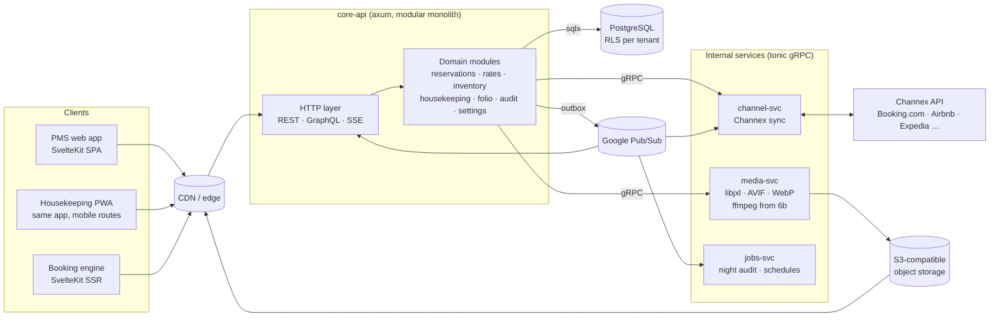
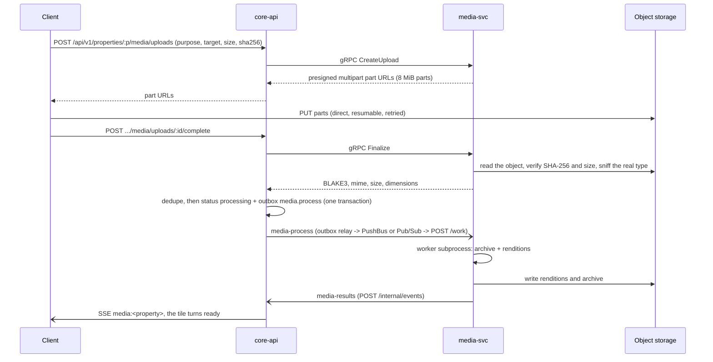

# GoodFolk PMS — Architecture

Status: **v0.8** (2026-10-18). v0.8 records what Phase 7a built: folios and append-only lines, the tax rules engine and Sri Lanka preset, desk payments, deposits and refunds, POS bills, gapless whole-LKR invoices and credit notes rendered by Typst, and the Central Bank exchange-rate import, with the rulings made on the way (§13). v0.7 records what Phase 6a built: the transactional outbox and event bus, service-to-service auth, the media pipeline (libjxl command line tools, exact SSIMULACRA2, worker subprocesses), RustFS in place of MinIO for local development, and the definer-function rules. v0.6 recorded the implementation decisions made while writing the Phase 0 plan: live updates over Postgres `LISTEN/NOTIFY`, SQL checked by integration tests, the `modules/` directory, and the outbox and Pub/Sub moved to Phase 6. Detailed references: [design/data-model.md](design/data-model.md), [design/api-conventions.md](design/api-conventions.md), [specs/](specs/). Decisions marked **[OPEN]** need confirmation before the related phase starts. See [ROADMAP.md](ROADMAP.md) for the delivery plan.

**Target scale (year one):** about 40 tenants, 100 properties, 1,000 rooms in total (roughly 10 rooms per property on average). Primary market: Sri Lanka. English only at launch; multiple currencies from day one.

---

## 1. Goals and non-goals

**Goals**

- A cloud-hosted, multi-tenant hotel PMS. A **tenant** (hotel group or independent owner) runs one or more **properties** from one account.
- Fast for staff: every screen should feel instant. Aim for p95 API latency under 50 ms for reads and under 150 ms for writes (excluding external calls), and interaction-to-next-paint under 100 ms.
- Backend in **Rust + axum** (fixed requirement).
- Pick the protocol per workload: **GraphQL** for data-heavy screens, **REST** for commands and simple CRUD, **gRPC** between internal services.
- A separate media engine that stores photos, video, documents and audio at the smallest size that is visually indistinguishable from the source, and keeps originals losslessly.

**Non-goals for v1**

- Building direct OTA connectivity ourselves (see §9: Booking.com has paused onboarding of new connectivity partners).
- Point-of-sale, spa, or restaurant modules (POS will be designed later; v1 defines only the POS → folio posting contract, §7.5).
- Native mobile apps. Housekeeping ships as an installable PWA.

---

## 2. High-level topology



### Why a modular monolith plus a few services

Hotel operations are highly transactional. A reservation write touches inventory, rates, folio and housekeeping in **one database transaction**. Splitting those into separate services turns local transactions into distributed sagas, which adds latency and many failure modes without adding speed. So:

- **`core-api`** is one axum binary made of strictly separated domain modules (one crate each). Modules call each other through Rust traits, not HTTP. Any module can be extracted later because its boundary already exists.
- **Separate services exist only where the workload is different in kind**, and they talk over **gRPC (tonic)**:
  - `media-svc`: CPU-heavy transcoding. It must not starve the API's tokio workers and scales on its own.
  - `channel-svc`: slow, retry-heavy calls to external systems with their own rate limits.
  - `jobs-svc`: night audit and scheduled work, which is long-running and must be idempotent.

This meets the "gRPC for microservices" requirement without paying the microservice tax on the hot path.

---

## 3. Technology choices

### 3.1 Backend (Rust)

| Concern | Choice | Notes |
|---|---|---|
| HTTP framework | **axum** + tower + tower-http | compression (br/zstd), tracing, timeouts, CORS, request IDs |
| GraphQL | **async-graphql** + `async-graphql-axum` | built-in DataLoader for batching N+1 queries; enforce query depth and complexity limits; persisted queries only in production |
| gRPC | **tonic** + prost | `.proto` files in `/proto`, shared through a `proto` crate. Compiled with `tonic-prost-build` and the pure-Rust **protox**, so no `protoc` is needed to build |
| DB access | **sqlx** (Postgres) | no ORM overhead, prepared-statement cache. Queries use the `sqlx::query*` functions (checked at run time), and every query is exercised by integration tests against real Postgres, so builds need no database or offline query cache |
| Allocator | **mimalloc** | measurable gains for many small allocations in async servers |
| Serialization | serde / serde_json | JSON for REST and GraphQL, protobuf internally |
| In-process cache | **moka** | rate and room-type metadata, config; invalidated through bus events |
| Messaging | **UI invalidation:** Postgres `LISTEN/NOTIFY` (every API instance listens; delivered only on commit). **Service events (from Phase 6):** transactional outbox → Google Pub/Sub (§5.3) | Pub/Sub pushes events to Cloud Run services, which can then scale to zero. Pub/Sub is behind an `EventBus` trait so it can be swapped out; `PushBus` stands in for it locally |
| Auth hashing | **argon2id** | |
| Observability | `tracing` + OpenTelemetry → OTLP | structured logs, traces, RED metrics |
| Validation | `validator` / `garde` at the edge | every external input is validated before it reaches domain code |

Release profile: `lto = "fat"`, `codegen-units = 1`, `panic = "abort"`, `opt-level = 3`, built for the deployment CPU (`-C target-cpu=x86-64-v3`, or a Graviton target on ARM).

### 3.2 Frontend: **SvelteKit (Svelte 5, runes) + TypeScript**

Options compared:

| Option | Runtime speed | Bundle | Ecosystem for a data-heavy admin app | Verdict |
|---|---|---|---|---|
| **SvelteKit / Svelte 5** | Top tier. Compiled, no virtual DOM, fine-grained runes | Very small | Mature: TanStack Query and Virtual, headless UI kits, forms, i18n, PWA | **Chosen** |
| SolidJS / SolidStart | Slightly ahead in synthetic benchmarks | Very small | Much smaller ecosystem; SolidStart still changing | Runner-up |
| Leptos (Rust/WASM) | Excellent. Shares types with the backend | 30–80 KB WASM gzipped plus a JS shim | Fewer UI components; every DOM call crosses the JS/WASM boundary; slower build-edit loop | Not for v1 |
| React / Next | Good, but pays virtual-DOM re-render cost | Larger | Largest | Too heavy for the stated priority |

Why SvelteKit: benchmarks put Svelte 5 and Solid within noise of each other for real apps, and both are far ahead of virtual-DOM frameworks. SvelteKit's maturity reduces risk. Leptos is attractive for sharing Rust types, but the tape chart is DOM-heavy, and DOM work is where WASM↔JS glue costs the most. We get most of the type-sharing benefit through code generation (§3.3).

Frontend building blocks:

- **PMS app**: SvelteKit with `adapter-static` in **SPA mode**. It is behind login, so SSR adds nothing. Static assets are served from the CDN with immutable hashes.
- **IBE**: a separate SvelteKit app with **SSR** (SEO, fast first paint for guests), deployed to the edge or a Node/Bun runtime.
- Data: **TanStack Query (Svelte adapter)** for cache, deduplication, cancellation and prefetch. **TanStack Virtual** for large lists and tables.
- Styling: plain CSS with design tokens (custom properties), no runtime CSS-in-JS. Minimal motion, with `prefers-reduced-motion` respected.
- Headless components: **Bits UI** (Svelte 5), for accessible modals, menus and comboboxes.
- i18n: **Paraglide** (translations are compiled in, so unused strings are removed from the bundle). English only at launch, but no hard-coded UI strings, so adding a language is only translation work. Numbers, dates and money are formatted with `Intl`.
- Everything is keyboard-first: front-desk staff use shortcuts all day.

### 3.3 Type sharing (Rust → TypeScript)

- GraphQL: SDL is exported from async-graphql and types are generated with **GraphQL Codegen** (typed document nodes).
- REST: DTOs derive **`utoipa`** OpenAPI, and TS clients are generated with **openapi-typescript**.
- CI fails if the generated files differ from what is committed.

### 3.4 Data and infrastructure: Google Cloud, free tier first

We need a generous free tier until hotels are onboarded, plus an easy way to run several gRPC services. **GCP Cloud Run** fits best:

- It has an always-free allowance, around 180k vCPU-seconds, 360k GB-seconds and 2M requests per month. AWS App Runner has no always-free tier and is in maintenance mode, and Azure Container Apps' cold starts are slower.
- It runs any container, scales to zero, and supports **HTTP/2 end-to-end, so gRPC between services works as-is**. Services call each other with Google-signed service identity tokens, so we don't have to build internal auth.
- Each "microservice" is simply another Cloud Run service built from the same repo. No Kubernetes to operate.

| Concern | Choice | Free tier / later |
|---|---|---|
| Compute | **Cloud Run** services: `core-api`, `media-svc`, `channel-svc`, `jobs-svc` | Free allowance, then pay per use. `core-api` gets `min-instances=1` once hotels are live, to avoid cold starts on the front desk |
| Primary DB | **PostgreSQL 17** on **Neon** (serverless Postgres, scale-to-zero, built-in pooler) | Free: 0.5 GB and 100 CU-hours per month, enough for development and pilots. Move to Neon's paid plan or Cloud SQL at launch. It is plain Postgres, so migrating is a dump and restore |
| Connection pooling | sqlx pool per instance → Neon pooler (transaction mode, which is compatible with `SET LOCAL`) | |
| Object storage | **Cloudflare R2** (S3 API, **zero egress fees**) | 10 GB free. **RustFS** for local dev: MinIO's community edition is archived and no longer ships binaries, and RustFS is Apache-2.0 and S3-compatible |
| Event bus | **Google Pub/Sub** (push subscriptions to Cloud Run) | Large free monthly allowance. Locally, `PushBus` posts straight to the receiver; the emulator is supported (`PUBSUB_EMULATOR_HOST`) |
| Scheduling | **Cloud Scheduler** → `jobs-svc` every 15 min; the service works out which properties are due for night audit | 3 jobs free |
| CDN / DNS | **Cloudflare** (static SPA, media renditions, IBE edge cache) | Free plan |
| Secrets | **Secret Manager**, mounted into Cloud Run at runtime. Never in the repo | Small free allowance |
| Region | **Singapore**: Cloud Run `asia-southeast1`, Neon `aws-ap-southeast-1`, Pub/Sub and Secret Manager in `asia-southeast1`, R2 with an Asia-Pacific location hint. The app and the database sit in the same metro area, so database round trips stay short | |
| Build artifacts | Distroless image; Artifact Registry. `core-api` is a musl static binary (`Dockerfile`). `media-svc` is glibc on `distroless/cc`, with `tini` and the libjxl tools (`Dockerfile.media-svc`), because its C and C++ codecs are reliable there and not on musl | |

Cost notes:
- Open SSE connections count as active requests on Cloud Run. Once many front desks are live all day, `core-api` is effectively always on, so expect a small fixed monthly cost at that point. It is still cheap at this scale.
- AV1 video encoding is the heaviest CPU consumer. It runs only in `media-svc`, is triggered by Pub/Sub push, and can be capped with max-instances.

Local dev needs nothing from GCP. `docker compose` runs Postgres and RustFS, and `deploy/dev` has scripts for running both RustFS and the libjxl tools as plain binaries (no Docker). Only thin adapters (`EventBus`, object store) touch provider APIs.

---

## 4. Multi-tenancy

### 4.1 Model

```
tenant (hotel group / owner account)
 └── property (a hotel)
      ├── room_type → room
      ├── rate_plan → rate_day
      ├── reservation → reservation_room (stay) → folio
      └── housekeeping, blocks, audit days …
user ── membership(tenant) ── role grants (tenant-wide or per property)
```

### 4.2 Isolation strategy: shared schema + Postgres Row-Level Security

- Every tenant-scoped table has `tenant_id uuid NOT NULL`. Property-scoped tables also have `property_id`.
- RLS is enabled with `FORCE ROW LEVEL SECURITY`. The app connects as a role that is **not** the table owner and does not have `BYPASSRLS`.
- Each request runs in a transaction that begins with `SET LOCAL app.tenant_id = $1`. **Never use plain `SET`**, because pooled connections would leak tenant context into the next request.
- Policies call a `STABLE` SQL function (`app.current_tenant()`) rather than `current_setting()` inline, so the planner can still use indexes. Naive policies are known to cause very large regressions.
- Every composite index **leads with `tenant_id`** (or `property_id`).
- Defense in depth: queries also filter by `property_id` explicitly, and RLS is the safety net.
- An integration test suite tries cross-tenant reads and writes on every table and must see zero rows or an error.
- Escape hatch: large enterprise tenants can later be moved to a dedicated database by pointing their `tenant_id` at a different pool (routing lives in one place).

### 4.3 IDs, time and money

- IDs: **UUIDv7** (time-ordered, index-friendly, no enumeration). Human-facing confirmation numbers are separate short codes, unique per property.
- Time: `timestamptz` for events. **Stay dates are `date` in the property's time zone.** Each property has an IANA time zone and a **business date** that only moves forward at night audit.
- Money: `bigint` minor units **plus an ISO-4217 currency code on every amount**. Never floats. Taxes and rounding rules are configured per property.

### 4.4 Multiple currencies

- Each property has a **base currency** (for example LKR), used for reporting and statistics. It also has a list of **accepted currencies** (for example USD, EUR, GBP, LKR at launch; any ISO-4217 code can be added).
- Each **rate plan has one sell currency**. Non-resident plans are typically in USD and resident plans in LKR (see §7.2).
- An **exchange rate table** per property, `fx_rate(property, date, currency, rate_to_base numeric(18,6), source: cbsl | manual, source_date)`, holds base currency per one unit of the currency. Default source: the **Central Bank of Sri Lanka daily selling rate**. This is the average telegraphic transfer (TT) selling rate quoted by licensed commercial banks at 9:30 a.m. on each working day, published for the main currencies. A base amount uses the latest rate dated on or before the line's business date; a foreign-currency posting with none is refused (`409`, "No exchange rate for USD on <date>").
  - The Central Bank has **no official API**, so the fetcher reads its published results form (`exrates_resultstt.php`) behind a `RateSource` trait, for the nine currencies it publishes, and only for properties whose base currency is LKR. It was a core-api task in Phase 7a; since Phase 7b it is a `jobs-svc` job (`modules/fx`): on its first tick and then every day from 10:30 `Asia/Colombo` (checked every 15-minute tick, under a session advisory lock so one instance imports), switchable with `FX_IMPORT=off` (the end-to-end suite). The night audit locks each closed day's rates, and the import skips a closed date. If the page layout changes, parsing fails loudly: the property gets an `fx_alert`, shown as a banner to owners and managers until a complete import clears it, and yesterday's rate is **not** reused silently. A rate is stored with the date the bank published it, so a stale one never passes as today's.
  - Weekends and holidays have no new rate, so the last published rate applies and is stored with the date it came from (`source_date`).
  - Staff with the `FxOverride` permission (owner, manager) can enter a rate by hand for a property, currency and date. It replaces the imported rate for that day, a later import does not undo it, and it is recorded in the audit log (`fx.overridden`, with the previous rate).
- Folio lines keep their **original currency and amount**, plus the base-currency equivalent at the rate for that business date. **Night audit locks the day's rates** (7b), so reports never change after the fact.
- Payments can be in any accepted currency. The folio balance is shown in the folio currency, with the base-currency equivalent next to it.

---

## 5. API design

### 5.1 Protocol per workload

| Surface | Protocol | Examples |
|---|---|---|
| Data-heavy read screens | **GraphQL** (`POST /graphql`) | tape chart tiles, reservation grid, reservation detail, inventory calendar, rate grid, housekeeping board, dashboards |
| Commands / simple CRUD | **REST** (`/api/v1/...`) | create/modify/cancel reservation, check-in/out, assign room, set room status, block dates, upload media, auth, settings |
| Live updates | **SSE** (`GET /api/v1/events?property=`), fed by Postgres `LISTEN/NOTIFY` | "tile X changed", "room 204 now clean"; the client invalidates the matching query cache. The stream opens with a `ready` event so proxies forward headers immediately |
| Service to service | **gRPC** | core-api → media-svc, channel-svc, jobs-svc |
| External webhooks | REST | Channex bookings, payment provider events (signature verified) |

GraphQL is **read-only (queries only)**. All writes go through REST commands. Each write has one clear endpoint with idempotency keys and simple authorization, and GraphQL stays cache-friendly and easy to cost-limit.

SSE instead of GraphQL subscriptions: it is one-directional, works over plain HTTP/2 through every proxy, reconnects on its own, and is cheap on the server. Events carry **invalidation keys, not data**. The client refetches only what is on screen.

### 5.2 Conventions

- REST: JSON, `Idempotency-Key` header required on all POSTs that create things, optimistic concurrency with a `version` column and `If-Match`, RFC 9457 problem+json errors, cursor pagination.
- GraphQL: persisted queries in production (a hash allowlist), depth limit 8, a complexity budget per query, and DataLoaders for every relation.
- Versioning: `/api/v1` for REST. GraphQL evolves through additive changes and deprecation.

### 5.3 Service events: the transactional outbox

A change that other services must hear about (a photo ready to process, later a rate change for the channel manager) is never published straight from a handler: a crash between the commit and the publish would lose it, and a publish before the commit could announce something that rolls back.

- **Enqueue in the business transaction.** `events::enqueue(tx, topic, payload)` inserts an `outbox` row in the same transaction as the change, so the event exists exactly when the change does. Its id (a UUID v7) is the message id. Code never calls the bus directly.
- **Wake-up, not polling.** `app.outbox_enqueue` also runs `pg_notify('gf_outbox')`, which Postgres delivers only if the transaction commits. Each API instance's existing `LISTEN` connection (§3.1) hears it and wakes that instance's relay (`events::run_relay`). An idle relay otherwise polls every **30 s**, so an idle Neon database can scale to zero.
- **Relay.** It claims rows with `for update skip locked`, publishes each through the `EventBus` trait and marks it sent. A failed send is retried with backoff (1 s doubling, capped at 5 min); a permanent refusal is finished with its reason kept. Delivery is **at-least-once**.
- **Buses.** `PubSubBus` publishes over the Pub/Sub REST API with metadata-server tokens in production (or to the emulator). `PushBus` posts the message straight to the receiver's endpoint in Pub/Sub's push format; it is for development and tests, and `EVENT_BUS=push` is refused when `APP_ENV=production`. The same receiving handlers serve both.
- **Receivers dedupe on the outbox id.** Each records the message id in `processed_event` inside its own transaction, so a redelivery is a no-op `200`. A crash anywhere between claim and mark-sent redelivers the row, and it applies once.
- **Housekeeping.** The daily media sweep purges sent outbox rows after 7 days and `processed_event` rows after 30. Neither table is tenant data: both are reached only through `security definer` functions (§11).

### 5.4 Service-to-service auth

Every internal endpoint (`POST /internal/events` on core-api, `POST /work` and the gRPC service on media-svc) sits behind the `svc-auth` tower layer, outside the session and CSRF layers. In production it checks a **Google-signed ID token** against Google's JWKS (cached, with a bounded stale grace), the expected audience, and the caller's service account against `ALLOWED_SERVICE_EMAILS`. Locally it compares `Authorization: Bearer <INTERNAL_SHARED_SECRET>` in constant time, and production refuses to start in that mode. Outgoing calls take their header from a `TokenSource`, which `PushBus` receives as a closure so `events` does not depend on `svc-auth`.

---

## 6. Front desk tape chart: viewport-driven loading

This is the most performance-sensitive screen. Requirement: **only load what is on screen**, fetched as the user scrolls horizontally, and keep it smooth.

### 6.1 Data shape

- **Rows**: rooms grouped by room type (plus an "unassigned" lane per type). Room metadata is small (a 300-room hotel is about 15 KB), so it is loaded once, cached and virtualized **vertically**.
- **Columns**: dates, virtualized **horizontally**. The timeline is effectively infinite in both directions.
- **Bars**: reservation stays and room blocks. Only these are fetched on demand.

### 6.2 Tile-based fetching

Fetching the exact pixel viewport would change the query on every scroll frame, and nothing would ever come from cache. Instead the timeline is cut into **fixed, aligned tiles**, similar to how map apps load tiles:

```
tile key = (property_id, tile_start_date, row_block)
tile span = 14 days (aligned to a fixed epoch, so keys are stable)
row_block = 50 rooms (only used for properties with more rooms than fit comfortably; otherwise one block)
```

At the expected scale (about 10 rooms per property on average), a property fits in one row block, so tiles are keyed by date only. Row blocking is kept in the design for large hotels, but it switches on only above 50 rooms.

1. On scroll (throttled with `requestAnimationFrame`), compute which tiles intersect the viewport.
2. Request any missing tiles with **1 tile of overscan** in the scroll direction, so data is ready before it becomes visible. Overscan is configurable; 0 gives strictly on-screen loading.
3. Earlier requests for tiles that have scrolled away are **aborted** (`AbortController` through TanStack Query).
4. Tiles are cached by key with an **LRU cap** (for example about 12 tiles) so memory stays flat however far the user scrolls.
5. A stay crossing tile boundaries shows up in both tiles. The client deduplicates bars by `stay_id`.
6. SSE events include the affected tile keys, and only those tiles are refetched, and only if they are cached.

### 6.3 Minimal payload

The tile query returns just enough to draw bars: `id, room_id, room_type_id, start, end, status, guest_display (short), source, flags (vip/paid/notes bitmask), version`. Everything else (guest profile, folio, notes) is fetched **when a bar is clicked**. Tiles also carry per-day **availability counts per room type** for the header row.

```graphql
query TapeTile($property: ID!, $from: Date!, $to: Date!, $rooms: [ID!]) {
  tapeTile(propertyId: $property, from: $from, to: $to, roomIds: $rooms) {
    stays  { id roomId roomTypeId start end status guest source flags version }
    blocks { id roomId start end reason }
    availability { date roomTypeId free }
  }
}
```

### 6.4 Server side

- `reservation_room.stay` is a `daterange`. There is a **GiST index on `(property_id, stay)`** (with `btree_gist`), and the tile query is one indexed `stay && daterange($from, $to)` scan.
- **Double booking is impossible at the database level**: `EXCLUDE USING gist (room_id WITH =, stay WITH &&) WHERE (status NOT IN ('cancelled','no_show'))`.
- Target: under 10 ms server time per tile, and a compressed payload of a few KB.

### 6.5 Rendering

- One scroll container. A CSS grid draws the background (day lines and weekend shading) with `background-image` gradients, so there are **no per-cell DOM nodes**.
- Only bars inside the virtual window are DOM elements, absolutely positioned with `transform: translate()`.
- Drag to move or extend a stay uses pointer events, updates optimistically, then sends a REST command. If the command conflicts (version or exclusion violation), the bar snaps back with a message.
- Sticky room rail and sticky date header use `position: sticky`, with no JavaScript scroll syncing.
- Fallback: if profiling shows DOM limits on very large properties, the grid layer can switch to `<canvas>` while bars stay in the DOM for accessibility.

---

## 7. Domain modules

### 7.1 Reservations

- Hierarchy: `reservation` (booker, source, channel, confirmation #, guarantee) → one or more `reservation_room` (room type, optional assigned room, stay range, occupancy, rate plan, meal plan) → `folio`.
- Reservation grid (GraphQL): server-side filtering, sorting and cursor pagination. It renders with TanStack Virtual and keeps a fixed number of DOM rows.
- Clicking a row opens a **large modal** whose URL is `/reservations/:id` (deep-linkable, and the browser back button closes it). Detail data is prefetched on row hover or keyboard focus, so the modal usually opens with data already loaded.
- New reservation: availability search → pick room type, rate and meal plan → guest → guarantee or payment. It is a single REST `POST` with an idempotency key. The server re-validates availability and price inside the transaction.
- Statuses: `tentative → confirmed → checked_in → checked_out`, plus `cancelled` and `no_show`. Transitions are enforced by a state machine in the `domain` crate.

### 7.2 Rooms and rates

**Room types**: name, code, capacity (base, max adults and children), bed configuration, amenities, media. They can be imported from a channel mapping (see §9).

**Rate plans** have three kinds:

| Kind | Meaning |
|---|---|
| **Standard (parent)** | Prices set directly per room type, per date, per occupancy |
| **Derived** | Price = parent price ± percent or fixed amount, with a rounding rule. Options to inherit restrictions (min/max stay, CTA/CTD, stop-sell), and a derivation chain depth limit of 3 |
| **Custom** | Standalone, set directly, not linked to anything |

**Segment / distribution tags** on rate plans: `FIT-F`, `FIT-L`, `OTA`, `TA`, `IBE`. Each controls where the plan is sold (IBE, channel manager, TA contracts). Any of them can be standard or derived. For example, "OTA = BAR +15%" and "IBE = BAR −5%".

**FIT-F / FIT-L (residency):**

| Tag | Guest | Typical currency | Rule |
|---|---|---|---|
| `FIT-F` | Foreign (**non-resident**) | USD (or another foreign currency) | Only sellable to guests whose residency is non-resident |
| `FIT-L` | Local (**resident**) | LKR | Only sellable to residents |

- Every guest profile has a **residency** field (resident / non-resident) and a country of residence. The IBE asks for residency before showing prices and only shows the matching plans. Front-desk staff see a warning if they apply a plan that doesn't match the guest's residency.
- **Resident prices are set by hand.** Derived plans must use the **same currency as their parent**, and the system rejects derivation across currencies. FIT-L plans are usually standalone LKR plans, or derived from another LKR plan. Exchange rates are used only for folio conversion and reporting, never to create prices.
- Compliance with Central Bank rules: licensed hotels must accept payment from **non-residents in foreign currency**, unless there is documentary evidence that the rupees were converted through a licensed bank. The folio therefore **flags an LKR payment on a non-resident's folio** and asks for the evidence reference (the reference number and an uploaded document).

**Meal plans**: `RO` (room only), `BB` (bed and breakfast), `HB` (half board), `FB` (full board). Modeled as a **per-person-per-night supplement** (adult and child prices) on top of the room price, so one parent rate can be sold in every meal plan without copying price grids. A rate plan lists which meal plans it allows. A property can instead choose to price meal-inclusive plans directly (as a derived plan with a fixed offset).

**Price resolution and storage**

- `rate_day(rate_plan_id, room_type_id, date, occupancy, amount, restrictions…)` stores **resolved** prices for every plan, derived ones included.
- When a parent price changes, the derived rows are recomputed **inside the same transaction** (bounded: a handful of plans × dates changed). Reads (rate grid, IBE search, channel push) never compute derivations at query time. They are plain indexed range scans.
- Bulk edits (for example "+10% for all of July") are one REST command that updates the parent rows and their descendants set-based in SQL.

### 7.3 Inventory

- `inventory_day(property_id, room_type_id, date, physical, sold, out_of_order)` keeps a counter row per room type per day, from the business date for 730 days, updated in the same transaction as the room, reservation or block. Availability reads are then O(days), with no counting over reservations.
- Correctness guard: a nightly job recomputes counters from the source tables and alerts on drift.
- **Room blocks**: `room_block(room_id, range, reason, kind, note)` with `kind = out_of_order` (removed from inventory, for renovation or construction) or `out_of_service` (still sellable, but flagged). Reason codes are configurable per property. Blocks show on the tape chart and reduce availability. They cannot overlap existing stays unless the overlapping stays are moved first; the server returns the list of conflicts.
- Inventory calendar screen (GraphQL): room types × dates grid showing free/sold/blocked, plus restrictions, windowed by month.

### 7.4 Housekeeping

- Room status has two dimensions:
  - **Occupancy**: vacant / occupied / due out / due in (derived from reservations).
  - **Condition**: `dirty → cleaning → clean → inspected`, plus `out_of_order` / `out_of_service` (from blocks).
- Check-in is only allowed into `clean` or `inspected` rooms (configurable). Check-out automatically sets the room to `dirty`.
- Housekeeping board (GraphQL) with filters by floor, section, housekeeper and status. The PWA view for housekeepers shows only **their assigned rooms**, big touch targets, and works offline (a queue replays when the connection returns).
- **Issue reports**: room, category, severity, description, photos (via media-svc), status (`open → in_progress → resolved`), and assignee (maintenance). A high-severity issue can automatically suggest an out-of-order block.
- **Laundry** (`modules/laundry`, [spec](specs/laundry.md)) has two parts:
  - **Hotel linen**: items (`linen_item`, a code per property), locations (`store`, floor `pantry` for one housekeeping section, in-house `laundry`, outside `vendor`) and a par per room type and item (`linen_par`).
    - **Stock** (`linen_stock`) changes only through append-only movements (`receive`, `transfer`, `send`, `return`, `write_off`) written in the same transaction, so a location's stock always equals what moved in minus what moved out, and a movement that would take it below zero is refused (`409`). A movement locks its locations and item, then the stock rows in ascending `(location, item)` order, then a per-property advisory lock for the alert, which is always the transaction's last lock.
    - **Par totals** are read at the time: a pantry's is the sum over the active rooms of its section, the store's the sum over the active rooms in no pantry's section (a property has at most one active store), and a laundry or vendor has none.
    - **Low stock** is a stored `linen` ops alert (like FX and drift), recomputed after every movement and listing each location and item below par; it is shown to holders of `LinenManage`.
    - **Batches** (`laundry_batch`) are sent with a count per item (one `send` movement each) and received with the counts that came back (one `return` movement each, to a chosen location). Sent minus received is the difference, shown on the batch and audited; the missing items stay in the laundry's stock until a later `return` or a `write_off` against the batch settles them. A write-off by hand comes only from a store or pantry, and an item with stock can't be switched off, so every short batch stays settleable.
  - **Guest laundry service**: a price list per item code and service (`wash`, `press`, `dry_clean`, `express`; `express` has its own price per item), in the base currency and net of tax. An order is taken for a checked-in stay and copies each line's name and price, so later price changes do not alter it, even when its lines are edited (only prices new to the order are read from the list). Its status runs `collected → processing → ready → delivered` one step at a time, with `cancelled` allowed before delivery. **Charges are posted to the guest folio when the order is delivered**: the delivery locks the order, then reads the stay `for share` (a concurrent check-out finishes first), then the business date `for share`, and posts one line per order line through `folio::post_for_stay` (routing applies) with source and category `laundry`, taxed, dated the business date, under the posting key `laundry:<order>:<n>` (n is the line's position), all in one transaction. A refused posting (an invoiced folio, a stay checked out) refuses the delivery and the order stays `ready`. The lines appear at night audit like any other charge and count in `other_revenue`.

### 7.5 Folio and night audit

Phase 7a built the folio, payments, taxes (§7.6), POS bills and invoices (`modules/folio`, `modules/tax`, `modules/fx`); Phase 7b built the night audit below on top of them (`modules/audit`, `crates/jobs-svc`). The folio is in v1 scope: charges, payments, taxes, routing to a company, and multiple currencies (§4.4).

**Folios.** A folio is `guest` (one per reservation room), `account` (the city ledger: one **open** per account and property, created by its first charge; once it is invoiced the account's next charge opens a fresh one, and the account's folios are read open first, then the invoiced ones newest first) or `deposit` (one per reservation); the guest and deposit folios are created with the reservation. Unique partial indexes hold the "one per" rules. A folio is `open` or `invoiced`; an invoiced folio refuses every money command until a credit note reopens it. Its balance is per currency, with the base-currency (LKR) equivalent alongside.

**Lines are append-only.** `folio_line`, `folio_line_tax` and `payment` have no `update` or `delete` grant for the application role, nor has `invoice` (which can update only its `pdf_key`), and `folio` can update only `status` and `version`. A line records its `source` (`room`, `meal_plan`, `laundry`, `pos`, `manual`, `cancellation_fee`, `no_show_fee`, `adjustment`), `category` (`room`, `meal_plan`, `laundry`, `pos:<outlet>`, `misc`, `fee`), quantity, net amount and currency, its taxes, and the base amount at the rate for its business date (`round_half_up(amount × rate)` in exact decimals, never floating point; a conversion too large to hold is an error, never clamped). Corrections are new rows:
- a **reversal** is an equal negative line (`reverses`, with a reason), carrying negated copies of the original's taxes; a line is reversed once and a reversal never again;
- a **transfer** is a reversal on the source folio plus an identical line on the target, linked by `transfer_id`, in one transaction, between folios of one property;
- a staff charge is never negative: a mistake is reversed, not posted as a credit.

**Posting keys.** A system posting carries a key naming the charge: `room:<reservation_room>:<date>`, `meal_plan:<reservation_room>:<date>`, `pos:<bill>:<n>`, `cancellation:<reservation_room>` and `no_show:<reservation_room>`. A unique index holds a key **per tenant** (not per folio), and each embeds a globally unique id, so a replay finds its line wherever routing or a change of account has since sent it, and posts nothing. A key whose line was reversed stays used. Every system posting goes through `folio::post_for_stay`, which applies the routing; `post_charge` posts to a named folio and is for staff.

**Routing.** A reservation billed to an account has `routing_rule` rows (category → account), which default to `room` and `meal_plan` when it is booked and which `FolioAdjust` edits. A charge for a stay lands on the account's folio when a rule names its category, otherwise on the stay's folio; a later change affects only later postings. Changing the reservation's account re-points the rules, and clearing it deletes them. Charge to account is a payment on the stay with an untaxed `adjustment` line on the account's folio, undone by moving that line back, never by a refund.

**Room and meal-plan nights.** `post_business_date_charges(property, date)` posts, for every checked-in stay in house on the date, the room night from `reservation_night`'s price snapshot and the meal-plan supplements, each stay in its own transaction (a stay that fails, such as for a missing exchange rate, is reported and skipped, and the others post). It is idempotent through the posting keys. Staff run it for the current business date from **Post tonight's charges**; 7b's close calls the same function, and each stay's posting refuses a date the close has since rolled past ("That day is closed"). Check-out first posts every night stayed and still unposted, up to `min(departure, business date + 1)`, so none is missed. An **early check-out** reverses the `room` and `meal_plan` lines already posted for the nights it releases ("Night released at early check-out"); one on an invoiced folio refuses the check-out.

**Payments.** A payment is one of `cash`, `card_terminal` (approval code, last four digits, brand; a card number is refused), `bank_transfer` (reference) and `account`, in any of the property's accepted currencies, with its base amount at the business date's rate, and optional evidence text. `transfer` is a fifth, internal method for a credit moving between two folios as a pair of payments sharing a `transfer_id`; staff never choose it. A **refund** is a negative payment in the original's currency and method, with the original's base amount in proportion, so a payment and its refunds net to zero in LKR; its total can't exceed the original, and the folio it is taken from (the payment's own by default, or another folio of the reservation) must hold that much credit in the currency. Neither a charge to account nor a `transfer` is refunded.

**Deposits and cancellation fees.** Payments taken before arrival go to the deposit folio. At the reservation's first check-in the deposit folio's balance in each currency moves to that stay as a pair of `transfer` payments with the base amounts carried exactly. Undoing the check-in moves back what the stay still holds; if another stay of the reservation is already checked in, the deposit stays on the deposit folio, refundable from it. When a reservation room is cancelled, **its own** Phase 3 cancellation penalty posts to the deposit folio as a `cancellation_fee` (key `cancellation:<reservation_room>`), in the room's currency, taxed, and tax-inclusive when its rate plan's prices include tax; the remaining credit is refunded (`FolioAdjust`) or written off by an `adjustment`.

**POS bills.** `POST /api/v1/properties/{p}/pos-bills` (`PosPost`: owner and manager, so a POS signs in as a manager-role user until Phase 8 adds a POS role) is idempotent on `(property, outlet, bill number)`: the same body returns the bill first posted, a different body under that number is `409`. Each item is taxed by the outlet's rules (category `pos:<outlet>`; an outlet with its service charge off is taxed as if the property had none). A bill to an in-house stay posts a line per item through `post_for_stay`; a bill settled at the outlet is recorded with its taxed lines and a payment attached to no folio, so the audit counts the revenue. A settled bill can't be refunded or voided yet. The gRPC `PostPosBill` waits for a POS service.

**Invoices.** Issuing needs a settled folio (zero in every currency) with at least one line, an `open` folio, and an LKR property. A guest folio of a checked-in stay also needs every night before `min(departure, business date + 1)` posted ("Post the stay's nights first"), and a folio is refused past what one PDF holds (2000 lines, 500 payments, 50 taxes; `media_types::MAX_INVOICE_*`, which media-svc's `/render` checks too). In one transaction, after the folio's lock, it takes `property_counter('invoice')` (credit notes: `credit_note`), snapshots the invoice data, marks the folio `invoiced`, audits `invoice.issued` and enqueues the `invoice-render` job. Refusals come before the counter is touched and a rollback gives the number back, so serials are **gapless** under concurrent issues: `<PROPERTY CODE>-<YYYY>-<NNNNNN>` and `CN-<PROPERTY CODE>-<YYYY>-<NNNNNN>`, one series per property that never restarts with the year (the year is the business date's). Every value is **whole LKR**: the total is the money settled, rounded once from the lines' base amounts; the line figures are shared out by the **largest remainder** method so they sum to it exactly; a reversed line and its reversal print as an exact **mirrored pair**; each on-bill tax is converted at its line's rate, summed per code and rate and rounded once; `net` is the total less the printed taxes, so the printed figures always add up. The total is also written in words. **The TIN rule:** the title is `TAX INVOICE` for a VAT-registered property and `INVOICE` otherwise, and a VAT-registered property with no TIN cannot issue. The purchaser is the account (name, TIN) for an account folio, or the guest otherwise. A **credit note** negates its invoice under the next credit-note serial and reopens the folio; an invoice is credited once, then a new invoice is issued as usual. An account has one open folio, so a credit note on an invoiced account folio is refused (`409`) while a newer one of that account is open; once that one is invoiced too, the credit note reopens the old one. media-svc renders the PDF with Typst (§8.3) from the stored snapshot, and `MediaResult::InvoiceRendered` sets the invoice's `pdf_key`; the link to it is signed for 5 minutes and audited (`invoice.viewed`).

**Locks, events and audit.** Folio commands lock their folio rows in ascending id order, after `inventory_day` and before `property_counter`, with the `reservation` row last (the full order is in [api-conventions.md](design/api-conventions.md)). Writes notify `folio:<id>` for every folio they touch and exchange-rate changes `fx:<property>`; the live stream sends those keys only to a user who holds `FolioView` for the property. Every staff action on money is audited (`folio.charge_posted`, `folio.line_reversed`, `folio.line_transferred`, `folio.payment_taken`, `folio.refunded`, `folio.deposit_moved`, `pos_bill.posted`, `invoice.issued`, `invoice.credited`, `invoice.viewed`, `fx.overridden`, `tax_rule.*`, `outlet.*` and others).

**Night audit (7b).** The audit runs per property for its business date D (`modules/audit`), started by a user from the **Night audit** page or, if nobody has closed D by its **audit moment**, automatically: D at the property's `audit_time` when that is 12:00 or later, otherwise D + 1 at that time (default 03:00). It is a **guided review**, `nightAudit(propertyId)`, followed by a checkpointed close (spec: [phase-7b-night-audit.md](specs/phase-7b-night-audit.md)):

1. **Arrivals not checked in**: confirmed and tentative stays due on or before D. Each is resolved as a **no-show** (confirmed only; it releases the room from D and posts the booked terms' no-show penalty to the deposit folio, key `no_show:<reservation_room>`, taxed like a cancellation fee), a **delayed arrival** (the stay starts on D + 1; a one-night stay is refused) or a **cancel**.
2. **Departures not checked out**: checked-in stays due out on or before D, with their balances. **Check out**, or **extend a night** (a stay due out on D only: it gains the night dated D at its last night's price, with no quote, if the room is free and the night sellable). An overdue departure needs a person.
3. **POS bills** of D by outlet, each posted to a stay (room number) or settled at the outlet, with a total per outlet; a bill posted to a stay that has since checked out unsettled is highlighted.
4. **Booking bills**: a dry run of tonight's room and meal-plan postings for every in-house stay (the same code `post_business_date_charges` uses), flagging a stay that would fail, and the day's manual and fee lines by category.
5. **Payments** of D by method (a charge to account is the city ledger) and currency, with base totals and refunds. An LKR payment without evidence on a non-resident (`FIT_F`) stay, or on the deposit folio of a reservation with a `FIT_F` room, is flagged.

The close waits until every arrival and departure is resolved (manually: the review's blocking count must be zero). It runs in **`jobs-svc`**, which core-api calls over gRPC (`StartClose`, `RetryClose`) and which also runs it from its 15-minute tick; one run per `(property, date)` in `audit_run`, under the session advisory lock `hashtext('audit:' || property)`. Each step commits in one transaction with its `audit_run_step` row, so a crash loses all of a step or none of it and a rerun resumes at the first missing step:

1. `resolve`: manual runs only check that nothing is unresolved; automatic runs mark confirmed arrivals no-shows, cancel tentative ones and extend departures due out on D, and fail on anything refused or overdue.
2. `post_charges`: 7a's `post_business_date_charges(D)`; any stay that fails fails the run, listed with its room and reason.
3. `lock_fx`: each accepted currency's rate in effect on D is stored as D's own, and from then on neither a manual override nor the import touches a date before the business date.
4. `snapshot_stats` and `advance_business_date`, in one transaction holding `property` `FOR UPDATE`: D's `daily_stats` and `daily_stats_breakdown` (occupancy, ADR, RevPAR, revenue net of tax by segment, source, residency, room type and outlet, counts, taxes and payments, in LKR from stored base amounts), the business date to D + 1, `rooms::extend_window`, and the run `completed`. Writers read the business date `FOR SHARE`, so nothing dated D lands after its statistics are taken.

A failed run waits for **Retry**. A failed automatic run is retried by the tick until it has had 3 attempts, then raises an `ops_alert` (kind `audit`) that owners and managers see as a banner until the date completes; the tick never retries a failed manual run. Statistics are insert-only: a closed day is never rewritten, and a later correction counts on the day it is posted. Postings are write-once and corrections are reversals, never edits. The report PDFs and the liability reports read these snapshots in Phase 7d ([phase-7d-reports.md](specs/phase-7d-reports.md)).

**jobs-svc** (`crates/jobs-svc`, axum and tonic on one port, behind svc-auth) runs every scheduled job, each under its own advisory lock so overlapping ticks or instances never run one twice: crash recovery of `running` closes, the automatic closes, the exchange-rate import (moved from core-api, `FX_IMPORT`), the media sweep (moved from core-api), window extension, cleanup of expired sessions, sign-in failures and idempotency keys, and the inventory drift check (an `ops_alert` of kind `drift`, never a repair). In production Cloud Scheduler calls `POST /tick` every 15 minutes with an OIDC token, and the service runs with CPU always allocated so a background close finishes after the call returns. It connects as the application role and reads across tenants only through `SECURITY DEFINER` functions.

### 7.6 Taxes and service charge (Sri Lanka)

Researched September 2026 from primary sources where they exist (IRD, SLTDA) and secondary sources where they don't. Each fact below is marked **Confirmed** (primary source) or **Reported** (secondary source only).

#### 7.6.1 What each charge is

| Charge | Rate | Calculated on | Who it applies to | Status |
|---|---|---|---|---|
| **Service charge (SC)** | Usually **10%**, set by the hotel | Net amount | The hotel's choice, per category or outlet (restaurant and bar bills at minimum; many hotels also charge it on rooms) | A commercial charge, not a tax. Tax rules treat it specially (TDL excludes it) |
| **TDL** (Tourism Development Levy) | **1%**, or **0.5%** if annual turnover ≤ LKR 12M (quarterly ≤ LKR 3M) | Hotel turnover **excluding service charge (up to 10%) and VAT** | SLTDA-licensed tourist hotels. Paid **quarterly to SLTDA** | **Confirmed** (SLTDA) |
| **SSCL** (Social Security Contribution Levy) | **2.5%** of liable turnover. Hotels are "other services", so **100% of turnover** is liable | Turnover **excluding VAT** (and bad debts) | Businesses above the threshold: LKR 9M per quarter or LKR 36M per 12 months from 1 July 2026 (previously 15M / 60M). Monthly payment, quarterly return | Rate and base **Confirmed** (IRD). New threshold **Reported** |
| **VAT** | **18%** standard rate (since 1 Jan 2024). Hotels and restaurants are at the standard rate; the 2019–2022 concessions have ended | Value of supply (includes service charge) | Only **VAT-registered** properties: LKR 15M per quarter or LKR 60M per 12 months. The planned lower threshold was **abandoned** in July 2026 | **Confirmed** (IRD notice SEC/PN/VAT/2026-03) |

**Key points:**
- **TDL and SSCL are levies on the hotel's turnover, not taxes the law makes the guest pay.** A hotel either **passes them on** as bill lines (common in Sri Lanka) or **absorbs them** into its prices. The PMS must compute them either way, because the hotel owes them either way.
- **Which charges apply depends on the property.** A small guest house under the VAT threshold charges no VAT. A hotel under LKR 12M a year pays TDL at 0.5%. So registration status and the turnover band are **property settings**, not constants.
- **Possible SSCL exemption (Reported):** secondary sources list an exemption for "services provided to persons outside Sri Lanka, paid in foreign currency and remitted through a bank". Whether it covers **hotel stays**, where the guest is physically in Sri Lanka, is doubtful and **needs an accountant's ruling**. It may cover foreign tour operators and travel agents billed in USD. The engine supports it as a conditional exemption.

#### 7.6.2 What is still unclear: the order the charges are applied in

No official source spells out the full stack for a hotel bill, meaning whether VAT is charged on top of TDL and SSCL when those are passed on. Two approaches exist in practice:

| | **A: "cascade"** (VAT on everything passed on) | **B: "flat"** (every levy on net + SC) |
|---|---|---|
| Net (restaurant bill) | 10,000.00 | 10,000.00 |
| + Service charge 10% (on net) | 1,000.00 | 1,000.00 |
| + TDL 1% (on net, excluding SC as SLTDA requires) | 100.00 | 100.00 |
| + SSCL 2.5% (on net + SC + TDL) | 277.50 | (on net + SC) 275.00 |
| + VAT 18% (on net + SC + TDL + SSCL) | 2,047.95 | (on net + SC) 1,980.00 |
| **Total** | **13,425.45** | **13,355.00** |

The difference is about 0.5% of the bill, but **tax invoices must be exact**.

**Decision: order A (cascade) is the platform default.** Amounts passed on to the guest are part of the consideration, and therefore of the VAT value of supply. The engine still supports any order, so a property whose accountant rules otherwise changes settings, not code.

#### 7.6.3 How the engine works

Taxes are data, not code:

```
tax_rule(property_id, code, name, kind: tax | levy | service_charge,
         rate_bp,                                  -- 1000 = 10%
         applies_to: [charge categories],          -- room, meal_plan, laundry, pos:<outlet>, …
         base: [components included in the base], -- e.g. VAT base = [net, SC, TDL, SSCL]
         sequence,
         presentation: on_bill | absorbed,         -- absorbed = calculated and reported, not shown to the guest
         condition: always | vat_registered | residency(...) | payment_currency(...),
         effective_from, effective_to)
```

- Calculated **per folio line at posting time** and stored with the line (`folio_line_tax`: rule code, name, base, rate, amount, `on_bill` | `absorbed`), with the rules effective on the line's business date. Past bills never change. Rate changes are new effective-dated rows: ending a rule and adding another from a date. A rule in force on the business date (or earlier) can change only its name and a later end (`409`, "End it and add a new rule"), since lines already carry its taxes.
- `modules/tax` is pure: `calculate(net, category, rules, context) -> Breakdown` and `back_calculate(gross, …)`, with `validate` checking a rule set before it is saved (a base may name only `net` and rules calculated earlier, and a code is in force once on any day). A rule applies when its `applies_to` matches the category (`*`, `pos:*`, `pos:<outlet>`, …) and its condition holds (`vat_registered`, `residency`, `payment_currency`); a base component that did not apply contributes nothing.
- **Inclusive prices** (a rate plan with `prices_include_tax`, such as an OTA's) are worked backwards through the same rule stack, so net + components add up exactly to the inclusive amount; the rounding remainder goes to net.
- Rounding is in minor units per component, half-up, and the rounding remainder goes to the net amount, so the total always matches.
- **Service charge per category and per outlet**: the Sri Lanka rule `SC` applies to `pos:*`, and an outlet with its service charge off is taxed without it. Each has its own revenue account later, ready for staff service-charge distribution reports.
- **Liability reports** (7b): TDL per quarter (in SLTDA's format), SSCL per month and quarter, VAT per return period, and service charge collected. Each also includes the absorbed amounts.

**Sri Lanka preset** (applied when a property is created, and to existing properties by the 7a migration; then editable by the owner, `TaxSettingsManage`): `SC` 10% on `pos:*` (rooms off), `TDL` 1% on net (0.5% when the property's `tdl_small_turnover` is set), `SSCL` 2.5% on net + SC + TDL, `VAT` 18% on net + SC + TDL + SSCL only when `vat_registered`. Order A, everything on the bill, effective from 2026-01-01. **Apply Sri Lanka preset** replaces a property's rules with it from the day after its business date, so no posted line is touched. The property's tax settings (`vat_registered`, `tin`, `tdl_small_turnover`, `legal_name`, `address` and the accepted currencies) are columns of `property`, saved with `If-Match` and audited with the values before and after. On the Rs. 10,000.00 restaurant bill the engine gives exactly the 13,425.45 of order A above (and 13,355.00 for order B, in its tests).

#### 7.6.4 Tax invoice rules that affect the design

- **New standard VAT tax invoice format.** It was mandated for 1 April 2026, then **Reported** as deferred to **1 October 2026**. Requirements:
  - the heading "TAX INVOICE";
  - supplier TIN, and purchaser TIN where applicable;
  - the new serial number format;
  - invoice and supply dates;
  - VAT rate;
  - **values in LKR with no cents**;
  - the total in words;
  - the payment method.

  A USD folio therefore needs its **tax invoice in LKR**, converted at the day's locked rate (§4.4), with the USD amounts shown for reference. Invoice numbers use a gapless series per property, allocated inside the issuing transaction (§7.5). **As built (7a):** the invoice is a Typst template (`crates/media-svc/templates/invoice.typ`) over a stored data snapshot, so the IRD's final layout, once published, is a template change and not a code change; it follows the requirements above as far as they are known. The layout still needs the IRD specification.
- **Secured POS machines** (VAT Amendment Act No. 14 of 2026, **Confirmed**): VAT-registered businesses must use secured POS machines for transactions and invoices within three months of the specifications being published. The specifications are **not published yet**. This affects the future POS module and possibly PMS invoicing, so we will track it.
- **RAMIS web API** (**Confirmed**): IRD accepts VAT schedule data through CSV upload or a real-time web API from the taxpayer's system. This is a later integration: invoices would be pushed from the PMS automatically.

#### 7.6.5 Sources

- IRD, *Notice to Taxpayers SEC/PN/VAT/2026-03* (3 July 2026): VAT Amendment Act No. 14 of 2026, thresholds, secured POS, RAMIS. https://www.ird.gov.lk/en/Lists/Latest%20News%20%20Notices/Attachments/799/PN_VAT_2026-03_New_E.pdf
- IRD, SSCL. https://www.ird.gov.lk/en/Type%20of%20Taxes/SitePages/Social%20Security%20Contribution%20Levy%20(SSCL).aspx
- SLTDA, Tourism Development Levy. https://www.sltda.gov.lk/en/tourism-development-levy
- KPMG, Sri Lanka VAT to 18% from 1 Jan 2024. https://kpmg.com/us/en/home/insights/2023/11/tnf-sri-lanka-cabinet-approval-to-increase-vat-rate-to-18-percent-effective-1-january-2024.html
- Bizadvisor, SSCL guide (liable turnover by sector, thresholds). https://bizadvisor.lk/handbook/social-security-contribution-levy-sri-lanka
- Taxable.lk, SSCL amendment 2026. https://taxable.lk/blog/sscl-amendment-2026-sri-lanka
- Lanka Tax Club, SSCL exemptions. https://lankataxclub.lk/social-security-contribution-levy-sscl/
- VATupdate, standardized VAT tax invoice format. https://www.vatupdate.com/2026/03/30/sri-lanka-mandates-new-standardized-vat-tax-invoice-format-effective-april-1-2026/

### 7.7 Settings

Tenant: users, roles, properties, billing. Property: time zone, currency, taxes, check-in and check-out times, audit time, policies (cancellation, deposit), reason codes, housekeeping sections, channel connections, IBE branding.

**Roles and permissions**: RBAC with permission strings (`reservations.write`, `rates.edit`, `audit.run` …). Grants apply tenant-wide or per property. The API checks them in axum middleware and extractors, and the UI hides what the user cannot do.

---

## 8. Media engine (`media-svc`)

Goal: store any upload at the **smallest size with no visible quality loss**, and **keep the original bit-exact** so nothing is ever lost permanently. Phase 6a (photos and documents) is built; video and audio are Phase 6b ([spec](specs/phase-6b-video-audio.md)). The full scope, limits and tests are in [specs/phase-6-media.md](specs/phase-6-media.md).

Three purposes: `gallery` (room-type photos: public, permanent, immutable URLs), `issue_photo` and `guest_document` (private, reachable only through signed links of 60 and 5 minutes; every guest-document link is audited and scoped to the property that holds the document).

### 8.1 Flow



- Uploads go **directly to object storage** through presigned URLs. The bytes never pass through core-api.
- **Deduplication** is by content: the BLAKE3 of the file, unique per `(tenant, property, purpose)`. The same file uploaded twice to a property is stored once and linked twice; a failed match is queued again. Matching is never done across tenants (an upload could not learn that another tenant holds a file) or across a tenant's properties (each property's media lives and is deleted with it). Two completes racing for the same file leave one asset and two links, not a unique-violation error.
- Real type detection comes from magic bytes, never the extension, with a per-purpose allowlist and size limits. An image over 100 megapixels is refused before it is decoded. HEIC is recognised and refused.
- core-api never links the codecs: the types it shares with media-svc live in `crates/media-types`.
- Object keys are deterministic (`t/{tenant}/a/{asset}/upload`, `archive.jxl` (or `.jpg`, `.pdf`), `{size}.{format}`), so reprocessing a redelivered job overwrites with the same bytes.

### 8.2 Formats

| Media | Archival original (lossless) | Delivery renditions | Why |
|---|---|---|---|
| **Photos** | JPEG sources → **JPEG XL lossless JPEG transcode** (about 20% smaller, bit-exact reversible to the original JPEG); a JPEG cjxl cannot transcode (CMYK, for one) is kept as uploaded. PNG and WebP → lossless JPEG XL of the decoded pixels | **AVIF** (primary) + **WebP** fallback at `thumb` (320 square crop), `sm` 640, `md` 1024, `lg` 1600 and `xl` 2400 (long edge, never upscaled) | AVIF gives the best delivered size with universal-enough support. JXL is ideal for lossless archiving but is still behind a flag in Chrome, so it is not served to browsers. Delivered files are re-encoded from upright, sRGB pixels with no metadata, so no GPS survives |
| **Video** (6b) | Original kept as uploaded | **AV1 (SVT-AV1, 10-bit, preset ~5–6, CRF ~28–30)** in **CMAF / HLS**, plus **H.264** fallback rendition; audio **Opus** (AV1) / AAC (H.264) | AV1 is about 30–50% smaller than H.264 at the same quality, with hardware decode now common. CMAF uses one set of segments for HLS and DASH |
| **Audio** (6b) | Lossless sources → **FLAC**; lossy sources kept as-is | **Opus** 96–128 kbps | Opus is the most efficient general-purpose codec |
| **Documents** | Images archived as JPEG XL like photos; PDFs stored as uploaded (see below) | Images get `thumb` and `md`. **A PDF gets no thumbnail in 6a** (the UI shows an icon) | Compressing already-compressed PDFs gains little |

Deviations from the first design, all decided during 6a:
- **HEIC is refused**, not archived: no HEVC decoder can be vendored under the licence policy, and phones normally hand a browser a JPEG.
- **JPEG XL comes from libjxl's own `cjxl`/`djxl` (v0.12.0, BSD-3-Clause), run as subprocesses**, found through `JXL_BIN_DIR` (`deploy/dev/libjxl.sh install`). The Rust bindings (`jpegxl-rs`, `jpegxl-sys`) are GPL-3.0, which `deny.toml` forbids, and the official tools keep the byte-exact JPEG transcode.
- **libvips is not used.** Decoding is the `image` crate; `fast_image_resize` resizes, `moxcms` converts colour, `ravif` writes AVIF and `webp` writes WebP.
- **PDFs are not linearized** (that needs `qpdf`, a native tool we do not ship) and have **no first-page thumbnail** (a PDF engine arrives with 6b's tooling).

"No quality loss" means: delivered renditions are **visually lossless** and the **archival original is mathematically lossless**. The encoder quality for each format is the lowest whose `md` rendition scores SSIMULACRA2 ≥ 80 against the resized source; every rendition is then scored and any below 80 is re-encoded one step higher. The CI gate (`cargo test -p imaging --release --lib --test quality_gate`) decodes every delivered rendition of the fixture set and scores it **exactly, at full size** — never sampled. The scorer is a **port of the `ssimulacra2` crate (BSD-2)** that computes the same score in parallel row bands with a cached reference (it agrees with the stock crate to within 0.01), which is what keeps a 12 MP photo inside its 5 s gate. Re-encoding at better settings later is always possible from the archive.

### 8.3 Isolation and performance

- **Worker subprocesses.** Each job runs `media-svc worker` (a synchronous process with no async runtime) reading the job on stdin and writing the result on stdout, so a crash in a native decoder cannot take the service down. A job gets 60 s and a **3 GiB address-space cap** (`RLIMIT_AS`; it caps virtual address space, not memory in use, and is a backstop behind the 100 MP header check). The worker is its own process group, and a timeout or a cancelled request **kills the whole group**, so the `cjxl`/`djxl` children die with it. A worker starts with a **cleared environment** (only `RAYON_NUM_THREADS`, `JXL_BIN_DIR`, `HOME`, `PATH` and `RUST_LOG`), and media-svc marks itself **not dumpable**, so a worker cannot read the service's secrets from `/proc/<ppid>/environ` either.
- **`tini`.** In the container `media-svc` runs under `tini` as PID 1, which reaps any child orphaned by a kill and forwards signals (`Dockerfile.media-svc`).
- **Failures.** A crash or timeout is retried in-process up to 3 attempts (backoff 1 s, then 4 s); a file that cannot be decoded fails at once. Either sends `media.failed` with a short reason the UI shows. The sweep fails any asset still `processing` after an hour.
- **Invoice PDFs** (`POST /render`) are laid out in-process by Typst on a blocking thread, at most 2 at once, from `crates/media-svc/templates/invoice.typ` with the bundled Noto Sans (OFL-1.1, `crates/media-svc/fonts/`). They need no worker subprocess: Typst is pure Rust, the template is our own and it reads nothing but the invoice data. The PDF goes to the private bucket at `t/{tenant}/invoices/{invoice}.pdf`.
- **Concurrency.** `MEDIA_WORKERS` workers at once (default one per 8 CPUs, at least 1), each with an equal share of the CPUs as threads: one 12 MP job needs about 8 threads to be ready inside 5 s, so a few wide workers beat many narrow ones.
- **x86-64-v3.** `.cargo/config.toml` builds the whole workspace for `target-cpu=x86-64-v3` (AVX2, FMA). The encoders and the scorer need it to meet the gate; every GCP x86 machine and GitHub runner has it. On an older CPU the binary dies with SIGILL, so a Graviton target would need its own flags.
- **Gates** (never raise a threshold): upload init p95 < 50 ms server time including the gRPC call; a 12 MP JPEG `ready` in < 5 s from `complete`; a gallery of 50 photos paints in < 400 ms at p90.

### 8.4 Access, audit and retention

- Gallery renditions are written to the public bucket with `Cache-Control: public, max-age=31536000, immutable`. Everything else, the archive included, goes to the private bucket. A test pins that only gallery renditions are ever public.
- Signed GET links are made by core-api itself with its own read credentials. GraphQL returns no guest-document URL at all; the only way to a file is the audited REST call (`GET …/guest-documents/{id}/link`), which writes one `guest_document.viewed` entry per link. Housekeepers cannot list or link guest documents.
- A daily job in `jobs-svc` (core-api's until Phase 7b), under a Postgres advisory lock so only one instance runs it, deletes guest documents more than a year old whose guest has no stay departing within the last 365 days or later, removes unlinked assets after 24 hours, aborts uploads still `uploading` after 24 hours, fails stuck `processing` assets, and purges old outbox and `processed_event` rows.

### 8.5 Deployment notes

- **Cloudflare R2.** Create a public and a private bucket (`S3_PUBLIC_BUCKET`, `S3_PRIVATE_BUCKET`) and an API token for `S3_ACCESS_KEY` / `S3_SECRET_KEY` (`S3_REGION=auto`, `S3_ENDPOINT=https://<account>.r2.cloudflarestorage.com`).
  - **CORS on the private bucket:** allow `PUT` and `GET` from the app's origin and expose `ETag` (the browser sends part ETags back to complete the upload). The dev setup does this for localhost in `ensure_dev_buckets`; production is configured by hand.
  - **Lifecycle rule:** abort incomplete multipart uploads after 1 day, so abandoned parts are not billed.
  - **The public bucket sits behind the CDN domain**, and `MEDIA_PUBLIC_BASE_URL` is that domain; renditions are then served from the CDN edge with their immutable headers.
- **Pub/Sub.** Three topics. `media-process` and `invoice-render` (core-api publishes) have push subscriptions to media-svc `POST /work` and `POST /render`; `media-results` (media-svc publishes) has one to core-api `POST /internal/events`. Every subscription uses OIDC push authentication with the audience in `MEDIA_SVC_AUDIENCE` / `CORE_API_AUDIENCE`, each with its own push service account. Set `EVENT_BUS=pubsub` and `PUBSUB_PROJECT`, with `SVC_AUTH=google`.
  - **The `media-process` subscription's ack deadline is 600 s**, so a job that queues behind others is not redelivered while it runs. media-svc's Cloud Run **request timeout is 600 s**, matching the ack deadline, and its **concurrency is bounded** to about `MEDIA_WORKERS × 2`, so pushes wait at Cloud Run rather than piling up inside one instance. A push queued behind one job (up to about 185 s with its retries) and then running its own (another 185 s) stays well inside both.
  - **Every subscription has a dead-letter topic with `maxDeliveryAttempts`** (for example 5). A message the receiver refuses for good (a 400) then stops being redelivered and lands in the dead-letter topic.
- **Service auth (`ALLOWED_SERVICE_EMAILS`).** Each service lists exactly the accounts that call it:
  - **media-svc** lists core-api's runtime service account (its gRPC calls) and the push service accounts of the `media-process` subscription (`/work`) and the `invoice-render` subscription (`/render`);
  - **core-api** lists the `media-results` subscription's push service account (`/internal/events`).
- **media-svc on Cloud Run.** core-api reaches media-svc's gRPC over TLS at an `https://` `MEDIA_SVC_URL`, and refuses any other scheme in production. Deploy media-svc with end-to-end HTTP/2 (`gcloud run deploy … --use-http2`): Cloud Run otherwise downgrades the request to HTTP/1.1 at the container, and gRPC fails.
- **Images.** `Dockerfile` builds core-api (musl, distroless static). `Dockerfile.media-svc` builds media-svc on glibc for `distroless/cc`, copies in `cjxl` and `djxl` (`JXL_BIN_DIR=/opt/libjxl/bin`) and `tini`, and sets `APP_ENV=production`. The core-api build context must include `web/pms/src/lib/api/gql/persisted-documents.json` (§5.2).
- **Database.** core-api needs `DATABASE_LISTEN_URL` (a direct connection) for `LISTEN`, which also carries the outbox wake-ups. jobs-svc needs `DATABASE_DIRECT_URL` (a direct connection) for its session advisory locks.
- **jobs-svc on Cloud Run.** `Dockerfile.jobs-svc` builds it (glibc, `distroless/cc`, `APP_ENV=production`, port 8091). Deploy it with CPU always allocated (`gcloud run deploy … --no-cpu-throttling`), so a close started over gRPC keeps running after the call returns, and, as media-svc, with end-to-end HTTP/2 (`--use-http2`), since core-api calls it over gRPC at an `https://` `JOBS_SVC_URL`. In production it does not tick itself (`JOBS_TICK` defaults to `off`): a **Cloud Scheduler** job calls `POST /tick` every 15 minutes (`*/15 * * * *`) with an OIDC token whose audience is `JOBS_SVC_AUDIENCE`, from a service account listed in jobs-svc's `ALLOWED_SERVICE_EMAILS` beside core-api's runtime service account. A tick runs its closes one property at a time (a 200-room close takes about 1.5 s).
- **Owner policies at the first deployment.** jobs-svc's definer functions depend on the owner's `jobs_read`, `purge_idempotency` and `fx_import_read` policies. The development owner is a superuser, so the tests do not prove them: on Cloud SQL, whose owner is not a superuser, check that `app.jobs_properties()` lists every property, `app.jobs_open_runs()` sees a failed run and the cleanup deletes old idempotency keys.

---

## 9. Channels and imports (Booking.com, Airbnb …)

- **Booking.com has paused onboarding of new connectivity providers**, and Airbnb's API is invite-only. Direct integration is not realistic in the short term.
- Plan: integrate a **white-label channel manager API: Channex** (a single REST API to Booking.com, Airbnb, Expedia and 50+ OTAs, with bookings delivered by webhook). `channel-svc` owns this integration.
  - **Room type import**: when a property connects a channel, read the channel's room and rate mapping through Channex and offer to **create or match** local room types from it.
  - **ARI push**: availability, rates and restriction changes are emitted as events from the outbox, then debounced and batched per property by `channel-svc`, and pushed.
  - **Booking pull**: Channex webhook → verify signature → idempotent upsert of the reservation → acknowledge.
- `channel-svc` sits behind a `ChannelProvider` trait, so a direct connection can be added later without touching core.
- **Decision:** Channex is confirmed as the channel manager. OTA plans are usually sold in USD; `channel-svc` pushes each plan in its own currency, and mapping a plan to a channel checks that the currencies match.

---

## 10. Internet Booking Engine (IBE) — to be designed

The architecture reserves room for it; the detailed design waits on your input:

- A separate SvelteKit **SSR** app per tenant or property, on a custom domain or subdomain, with branding from settings.
- Public read endpoints (availability and price search) are served from `rate_day` + `inventory_day`, with a short edge cache (about 30 s) keyed by property, dates and occupancy. They are anonymous and rate-limited.
- Booking goes through the same REST reservation command with a hold-then-confirm flow and payment tokenization.
- Payments: see §10.1. **We never store card numbers**, only processor tokens.

### 10.1 Payments

How money is taken:

| Situation | Method | Integration |
|---|---|---|
| At the hotel (any guest, any currency) | **The hotel's own card terminal** (bank POS machine) | **No integration.** Staff record the payment on the folio: amount, currency, terminal/bank, approval code, card brand and last 4 digits. It appears in the night audit payments review for reconciliation against the terminal's settlement report |
| Online (IBE, pre-arrival deposits, card guarantees, payment links) in **LKR or foreign currency** | The **hotel's bank internet payment gateway**: **CyberSource** (primary) | Full integration (below) |
| Same, for hotels whose bank uses Mastercard Gateway | **Mastercard Payment Gateway Services (MPGS)** | Full integration (below) |
| Resident / LKR online, for small properties without a bank gateway | **payments.lk** | Optional, full integration |
| OTA virtual cards / OTA-collected payments | Channex / the OTA | Handled by the channel |
| Cash, bank transfer, city ledger | Manual folio payment | |

#### Which gateway each major bank offers (researched September 2026)

| Bank | CyberSource | Mastercard Gateway (MPGS) | Source |
|---|---|---|---|
| **Commercial Bank** | ✅ | ✅ (offers both) | ComBank |
| **HNB** | ✅ (first CyberSource reseller in Sri Lanka) | — | HNB |
| **Sampath Bank** | ✅ | — | Sampath |
| **Bank of Ceylon** | — | ✅ | BOC |
| **People's Bank** | — | ✅ | Daily Mirror |
| **Seylan Bank** | — | ✅ | Seylan |
| **Nations Trust Bank** (Amex acquiring) | — | ✅ | Daily FT |
| **NDB, DFCC, Pan Asia** | not found publicly | not found publicly | Confirm with each bank |

**Decision: support both gateways.** CyberSource covers ComBank, HNB and Sampath. The **Mastercard Gateway (MPGS)** covers BOC, People's Bank, Seylan, NTB and ComBank. Each hotel uses whichever gateway its own bank provides, and both are implementations of the same `PaymentProvider` trait.

#### CyberSource integration

- Card capture with **Unified Checkout** (or Microform hosted fields for an inline form). Card data goes directly to CyberSource and we receive a transient token, which keeps us at the lowest PCI scope (SAQ A).
- **Token Management Service (TMS)** turns that into a reusable customer token, used for guarantees, no-show fees and later charges. We store only the token.
- **Authorization at booking, capture at check-out or on the deposit date**, with 3-D Secure. Refunds and voids go through the Payments API.
- **LKR and foreign currency** through the same integration. The charge currency is the rate plan's currency. Which currencies a hotel can accept, and where foreign currency settles (a business foreign-currency account, as the Central Bank requires for non-residents), depends on the bank's merchant setup. This is covered in each bank's guide.
- API authentication uses **JWT with the merchant's key**. The older HTTP Signature method is being retired (migration deadline September 2026), so we do not implement it.
- Webhooks are encrypted with our public key, which is uploaded to CyberSource's key management. They are verified and decrypted, then the payment is upserted idempotently onto the folio.

#### Mastercard Gateway (MPGS) integration

- **Hosted Checkout**: our server calls *Initiate Checkout*, which returns a `session.id`. The page opens the gateway's payment page (redirect or embedded) through `Checkout.configure()`. Card data goes directly to the gateway, so we stay at the lowest PCI scope (SAQ A).
- **Tokenization**: the card is saved as a gateway token, used for guarantees, no-show fees and later charges. We store only the token.
- **Authorize at booking, capture at check-out or on the deposit date**, with 3-D Secure (the gateway's Authentication API). Refunds and voids use the same API. Charges are in LKR or foreign currency, as the bank's merchant setup allows.
- Authentication: HTTP Basic with `merchant.<merchant ID>` and the merchant's **API password**. Certificate authentication is supported later if a bank requires it.
- **The gateway host differs per bank or region** (for example the Asia-Pacific host, or a bank-branded host), so the **base URL is a per-property setting**, never hard-coded.
- **Webhooks**: the gateway sends the merchant's secret in the `X-Notification-Secret` header. We compare it in constant time, then **retrieve the order from the gateway API** to confirm its status before updating the folio. The payload alone is never trusted. The update is idempotent on the order and transaction ID.
- The REST API is versioned in the URL. We pin one version and upgrade on purpose.

#### Hotel setup guides (`docs/guides/payments/`)

- `cybersource.md`: the common technical steps. Enable Unified Checkout, TMS and 3-D Secure in the Business Center, create the REST (JWT) key, upload our webhook public key, and enter credentials in Settings → Payments. It ends with a sandbox test transaction before going live.
- `mpgs.md`: the same for the Mastercard Gateway. Enable Hosted Checkout, tokenization and 3-D Secure in Merchant Administration, create the API password, set the webhook URL and notification secret, and enter the gateway host, merchant ID and credentials in Settings → Payments. It ends with a test-merchant transaction before going live.
- **One page per bank**: `combank.md`, `hnb.md`, `sampath.md`, `boc.md`, `peoples.md`, `seylan.md`, `ntb.md`, plus `ndb.md` and `dfcc.md` once their platform is confirmed. Each covers:
  - which platform the bank uses and how to apply;
  - required documents: business registration, SLTDA licence, and so on;
  - fees as published;
  - supported currencies and settlement into a business foreign-currency account;
  - who to contact;
  - a link to the common technical guide for the platform.
- Bank-specific details (forms, fees, contacts) change and are not all public. **Each bank page will be written from the bank's current merchant documentation and checked with the bank's merchant team before we give it to hotels. Nothing will be guessed.** They are written in Phase 7, alongside the integration they describe.

#### payments.lk (Payable): optional, LKR only

- A REST API (bearer secret key, OpenAPI 3.1 spec) with a sandbox, hosted checkout with 3-D Secure, saved-card tokens and charge-later (`POST /v1/cards/:id/charge`), refunds, payment links, idempotency keys, and signed webhooks.
- No monthly fee: 2.29% up to Rs. 100k/month, 2.49% above, +1% for foreign cards. Useful for small properties that don't want a bank gateway.
- **LKR only**, so it cannot take non-resident payments (Central Bank rule). The PMS blocks routing a non-resident payment to it.

#### Common design

- Every provider implements one `PaymentProvider` trait: `create_checkout`, `authorize`, `capture`, `charge_saved_card`, `refund`, `verify_webhook`. Terminal and cash payments are a `manual` provider, so every payment type goes through one folio path.
- **Each property stores its own merchant credentials**, encrypted and kept in Secret Manager, because each hotel is its own merchant of record. Routing rules per property choose the provider by channel (online or at the desk), currency and guest residency.
- Webhooks from every provider go to one ingestion endpoint. Signatures are verified, then the payment is upserted idempotently onto the folio.

---

## 11. Security

- Auth: email + password (argon2id) with optional TOTP; SSO (OIDC) for enterprise tenants later. Sessions are **opaque tokens in `HttpOnly; Secure; SameSite=Lax` cookies**, stored hashed server-side and revocable. No long-lived JWTs in the browser.
- CSRF: SameSite cookies plus a custom-header requirement on state-changing requests.
- Authorization: tenant from the session → `SET LOCAL` → RLS. Property permission is checked in the extractor. The UI never decides authorization.
- Input validation at every edge. GraphQL cost limits. Per-tenant and per-IP rate limits.
- PII: encryption at rest (managed DB and storage), field-level encryption for ID or passport numbers, audit log of access to guest documents, and GDPR export and erase per guest.
- Append-only **audit log** for sensitive actions (rate changes, folio adjustments, overrides, permission changes, guest-document views and deletes).
- **`security definer` functions** (the guest search, the outbox and receiver-dedupe functions, the media sweep) all pin `set search_path = pg_catalog, public, pg_temp`, with `pg_temp` **last**. Postgres searches the session's temporary schema first for relations unless it is listed, so a `goodfolk_app` session could create a temporary table named `outbox` and have a definer function, running as the migration owner, write to it. Migration `0015` fixed the functions that `0009` and `0014` had already applied; every new definer function must do the same, revoke `public`'s execute, and grant it only to the role that needs it.
- The places the services cross tenants are the media sweep, through a read-only **`sweep_read` owner policy** (`for select to <owner> using (true)`) on the four media tables, and jobs-svc's property list, open runs and cleanup, through the `fx_import_read`, `jobs_read` and `purge_idempotency` owner policies; `goodfolk_app` is never a member of the owner, so the API gains nothing from them, and each effect is made in a tenant-scoped transaction. Details in [api-conventions.md](design/api-conventions.md).
- Dependency scanning (`cargo audit`, `cargo deny`, `pnpm audit`) in CI.

---

## 12. Repository layout (proposed)

```
GoodFolk/
├── Cargo.toml                # workspace: members crates/* and modules/*
├── crates/                   # services and shared infrastructure
│   ├── core-api/             # axum binary: REST, GraphQL, SSE, auth, migrate command
│   ├── db/                   # pool, migrations, tenant-scoped transactions, change events
│   ├── domain/               # pure business rules: state machines, pricing math (from Phase 3)
│   ├── proto/                # tonic-prost-build (protox) code from /proto
│   ├── media-svc/            # media gRPC + /work, supervised worker subprocesses
│   ├── media-types/          # job and result types shared by core-api and media-svc
│   ├── imaging/              # decode, resize, AVIF/WebP, JPEG XL archive, SSIMULACRA2
│   ├── storage/              # S3 client (presigned multipart and GET) and dev bucket setup
│   ├── events/               # outbox, relay and EventBus (PushBus, PubSubBus)
│   ├── svc-auth/             # Google ID token or shared-secret auth between services
│   ├── jobs-svc/             # night audit + scheduled jobs (Phase 7)
│   └── channel-svc/          # Channex integration (Phase 8)
├── modules/                  # one crate per business domain: identity, property, rooms, rates,
│                             # reservations, housekeeping, folio, tax, fx, payments, …
├── proto/                    # .proto contracts
├── migrations/               # SQL migrations (Postgres), applied by `core-api migrate`
├── web/
│   ├── pms/                  # SvelteKit SPA (includes housekeeping PWA routes)
│   └── ibe/                  # SvelteKit SSR booking engine (Phase 9)
├── deploy/                   # local dev support (Postgres roles, RustFS and libjxl scripts), Cloud Run definitions / IaC
└── docs/                     # architecture, roadmap, design references, phase specs and plans
```

---

## 13. Decisions log

| # | Topic | Decision |
|---|---|---|
| 1 | FIT-F / FIT-L | Non-resident / resident plans, mainly split by currency (§7.2) |
| 2 | Laundry | Both hotel linen and guest laundry service (§7.4) |
| 3 | Channel manager | Channex (§9) |
| 4 | Night audit | Guided review of arrivals/no-shows, departures, POS bills, booking bills and payments, then a checkpointed close (§7.5). POS itself will be designed later; the posting contract is defined now |
| 5 | Hosting | Free tier first on GCP: Cloud Run + Neon + R2 + Pub/Sub + Cloudflare, all in **Singapore** (§3.4) |
| 6 | Language / currency | English at launch, ready for more languages; multiple currencies (§4.4) |
| 7 | Payments | At the hotel: card terminal, recorded manually. Online: CyberSource **or** Mastercard Gateway (MPGS), whichever the hotel's bank provides, for LKR and foreign currency. payments.lk optional (LKR only). Setup guides for every major bank (§10.1) |
| 8 | Scale | About 40 tenants, 100 properties, 1,000 rooms |
| 9 | Resident pricing | Set by hand; no derivation across currencies (§7.2) |
| 10 | Exchange rates | Central Bank of Sri Lanka daily TT selling rate, fetched automatically, with a manual override (§4.4) |
| 11 | Taxes | Service charge, TDL, SSCL and VAT through an effective-dated, ordered rules engine, with a researched Sri Lanka preset. **Order A (cascade)** (§7.6.2) |
| 12 | Local object storage | RustFS replaces MinIO, whose community edition is archived (§3.4) |
| 13 | Service events | Transactional outbox, woken by `pg_notify('gf_outbox')` with a 30 s idle poll, PushBus locally and Pub/Sub in production, receivers dedupe on the outbox id (§5.3) |
| 14 | Photo pipeline | JPEG XL through libjxl's CLI tools (the Rust bindings are GPL), exact parallel SSIMULACRA2 as the CI gate, `x86-64-v3` build, worker subprocesses with a 3 GiB address-space cap killed by process group, `tini` as PID 1 (§8) |
| 15 | Photo scope | HEIC refused; PDFs neither linearized nor thumbnailed; dedup per property, not per tenant; guest documents scoped to the property that holds them (§8) |
| 16 | Definer functions | All pin `search_path` with `pg_temp` last; the media sweep and jobs-svc alone read across tenants, through owner policies (§11) |
| 17 | Folio lines | Append-only: the application role has no `update` or `delete` grant on lines, their taxes or payments, and a correction is a reversal, a transfer or a refund. A system posting carries a key unique **per tenant**, and all system postings go through `post_for_stay` (§7.5) |
| 18 | Routing and deposits | A reservation's account pays the categories its routing rules name (`room` and `meal_plan` by default); a deposit moves to the first stay at check-in and a cancelled room posts its own fee to the deposit folio (§7.5) |
| 19 | Refunds | A negative payment in the original's currency, method and rate, taken from a folio the caller names that holds the credit; a charge to account is undone by moving its line back; a settled walk-in POS payment can't be refunded yet (§7.5) |
| 20 | Early check-out | Reverses the lines posted for the nights it releases, and first posts any night stayed and unposted (§7.5) |
| 21 | Invoices | Whole LKR, gapless serial per property (one series, never restarting with the year, taken after the folio lock), largest-remainder allocation, mirrored pairs, `TAX INVOICE` only for a VAT-registered property, which needs its TIN; credit notes reopen the folio (§7.5) |
| 22 | Invoice rendering | Typst in media-svc, in process, from a snapshot (`InvoiceData` in `media-types`) queued on the `invoice-render` topic, with the PDF key returned as `MediaResult::InvoiceRendered`; the layout is a template, so the IRD specification needs no code change (§7.6.4, §8) |
| 23 | Exchange rates | The Central Bank TT selling rate through its results form, imported daily at 10:30 Colombo (`FX_IMPORT`; a core-api task in 7a, a `jobs-svc` job since 7b), with an alert banner, true `source_date`s and an audited manual override; LKR-base properties only; each closed day's rates locked by the night audit (§4.4) |
| 24 | Money permissions | Seven: `FolioView`, `FolioPost`, `FolioAdjust`, `InvoiceIssue`, `TaxSettingsManage`, `FxOverride` and `PosPost`; `folio:<id>` and `fx:<property>` events reach only users who hold `FolioView`. A POS uses a manager-role user until Phase 8's POS role |
| 25 | Account folios | One open per account and property; an invoiced one gives way to a fresh one at the next charge, and a credit note on it is refused while the fresh one is open, rather than reopening a second (§7.5) |
| 26 | Advisory exceptions | Typst's unreachable `quick-xml` advisories and unmaintained crates with no fixed release (and `paste`) are documented ignores in `deny.toml`, reviewed on every Typst upgrade |

## 14. Open questions

Worth confirming with an accountant before Phase 7. None of these change the design; each is a settings value:
- whether the SSCL foreign-currency exemption applies to hotel stays;
- whether hotels normally show TDL and SSCL on the bill or absorb them into prices;
- the final layout of the IRD tax invoice, once IRD publishes the specification.
